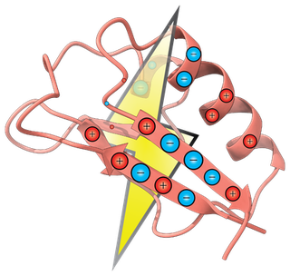

<div align="center">


<br/><br/>
[](https://doi.org/10.1021/acs.jctc.5c00138)
[](https://pypi.org/project/pycpet/)
[](https://pypi.org/project/pycpet/)
[](https://pycpet.readthedocs.io/en/latest/)

</div>

# *PyCPET*

Python-based Computation of Protein Electric Field Topology: high-throughput calculation of electric fields, electrostatic potentials and field topologies at enzyme active sites, from single structures or whole simulations. Most analyses run from one options file, and the library can be scripted for others.

**Documentation:** [pycpet.readthedocs.io](https://pycpet.readthedocs.io/en/latest/)

## Installation

*PyCPET* supports Python 3.9–3.12, and we recommend 3.11. Python 3.13 is not supported yet (see [#19](https://github.com/pujanajmera/pycpet/issues/19)).

```bash
pip install pycpet
```

To modify the code, install from the repository instead:

```bash
git clone https://github.com/pujanajmera/pycpet.git
cd pycpet
pip install -e .
```

Before running, limit OpenMP to one thread. With more than one thread, CPU topology calculations give incorrect results:

```bash
export OMP_NUM_THREADS=1
```

The [installation guide](https://pycpet.readthedocs.io/en/latest/Installation.html) covers conda setup, which platforms get prebuilt packages, compilers, source builds and GPU setup.

## Quick start

Write an options file, `options.json`:

```json
{
    "CPET_method": "point_field",
    "inputpath": "./pdb",
    "outputpath": "./out",
    "center": {"method": "mean", "atoms": [{"C7": 378}, {"O9": 378}]}
}
```

Then run:

```bash
cpet.py -o options.json
```

This computes the electric field at the midpoint of atoms C7 and O9 in residue 378, for every PDB file in `./pdb`, and writes one line per structure to `./out/point_field.dat`. The [`examples`](examples) folder has ready-to-run examples of this and other methods, and the [options reference](https://pycpet.readthedocs.io/en/latest/Options.html) lists every setting.

## Features

| `CPET_method` | Computes |
|---|---|
| `point_field`, `point_mag` | Electric field vector or magnitude at a point |
| `volume`, `volume_ESP` | Electric field or electrostatic potential on a 3D grid |
| `topo`, `topo_GPU` | Distribution of field streamlines (topology), on CPU or GPU |
| `cluster` | Clusters of topologies |
| `cluster_volume`, `cluster_volume_tensor` | Clusters of 3D fields, by direct distances or tensor decomposition |
| `cluster_volume_esp_tensor` | Clusters of 3D electrostatic potentials (beta) |
| `pca`, `pca_compare` | PCA of 3D fields, for one set or to compare sets such as variants (beta) |
| `visualize_field`, `visualize_esp` | BILD files to view fields or potentials in ChimeraX |
| `box_check` | Atoms intruding into the calculation box |

## Scripts

Scripts in `CPET/source/scripts` cover analyses outside `cpet.py`. Only `cpet.py` is installed as a command, so run these by their path. They are less thoroughly tested; see [Special Scripts](https://pycpet.readthedocs.io/en/latest/SpecialScripts.html).

- `electrostatic_interaction_QM.py`: electrostatic interaction energies, with a residue breakdown, for QM/MM calculations
- `residue_breakdown_analysis.py`: ranked residue contributions to field topology over a trajectory (beta)
- `tensor_based_cluster_double.py`: joint clustering of two sets of fields or potentials (beta)
- `field_topology_dipole.py`: streamline distributions from point dipoles (beta)

## Input files

Structures must be PDB or PQR files with charges. In PDB files, charges go in columns 56–64. See [Input Files](https://pycpet.readthedocs.io/en/latest/InputFiles.html) for the full rules.

## Citation

If you use *PyCPET*, please cite:

> Ajmera, P.; Vargas, S.; Chaturvedi, S. S.; Hennefarth, M.; Alexandrova, A. N. PyCPET─Computing Heterogeneous 3D Protein Electric Fields and Their Dynamics. *J. Chem. Theory Comput.* **2025**, *21* (8), 4299–4308. [doi:10.1021/acs.jctc.5c00138](https://doi.org/10.1021/acs.jctc.5c00138)
