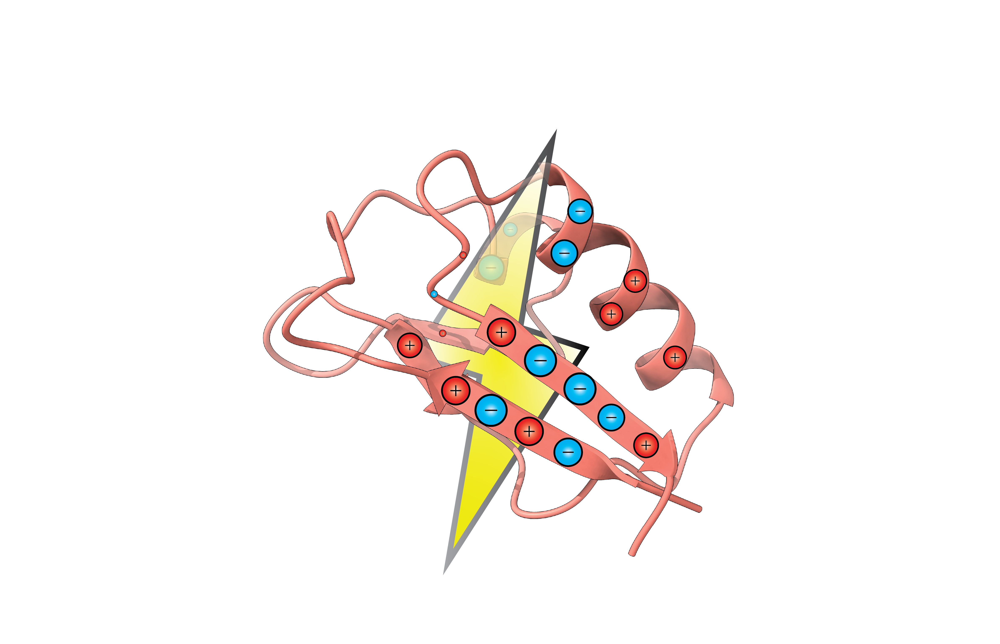

<div align="center">   
      

<br/><br/>
[](https://doi.org/10.1021/acs.jctc.5c00138)
[](https://pypi.org/project/pycpet/)
[](https://pypi.org/project/pycpet/)
[](https://pycpet.readthedocs.io/en/latest/)

</div>

# *PyCPET*

Python-based Computation of Protein Electric Field Topology, built for high-throughput accelerated calculations of several electrostatic properties of enzyme active sites from simulations. This program is incredibly flexible and scriptable for virtually any analysis of classical electric fields and electrostatic potentials.

## Cite
To cite your use of *PyCPET*, please use the following:
Ajmera, P., Vargas, S., Chaturvedi, S., Hennefarth, M. & Alexandrova, A. *PyCPET* - Computing Heterogeneous 3D Protein Electric Fields and Their Dynamics. Journal of Chemical Theory and Computation (2025). doi:10.1021/acs.jctc.5c00138

## Requirements and Installation
*PyCPET* supports Python 3.9–3.12. We recommend Python 3.11, the newest version for which every dependency installs prebuilt on Linux. Python 3.13 is not supported yet (see [#19](https://github.com/pujanajmera/pycpet/issues/19)).

Start from a clean conda environment (recommended, not required):

```bash
conda create -n pycpet-env python=3.11 pip -c conda-forge -y
conda activate pycpet-env
```

Then choose one of the following.

### Latest release (recommended for most users)

```bash
pip install pycpet
```

On Linux (x86_64) and on Apple Silicon Macs with macOS 14 or newer, this installs a prebuilt package whose C extension is already compiled with optimizations and OpenMP, so *PyCPET* itself needs no compiler. On other platforms, pip compiles *PyCPET* from source (see [Building from source](#building-from-source)).

One dependency, `scikit-learn-extra`, only has prebuilt packages for Python 3.11 and older on x86_64. On Python 3.12, and on every Apple Silicon Mac, pip compiles it during installation, which needs a C compiler. On macOS, install the Xcode Command Line Tools first with `xcode-select --install` (see [#19](https://github.com/pujanajmera/pycpet/issues/19)).

### Latest development version

To get changes before they are released, or to modify the code:

```bash
git clone https://github.com/pujanajmera/pycpet.git
cd pycpet
pip install -e .
```

Update later with `git pull`, and rerun `pip install -e .` if `CPET/utils/math_module.c` changed. This compiles the C extension on your machine (see below).

### Building from source
Source builds (the development version above, platforms without a prebuilt package, or `pip install --no-binary pycpet pycpet` to compile a release yourself) need gcc on Linux or the Xcode Command Line Tools on macOS. They compile the C extension for your own CPU (`-march=native`), while prebuilt packages target a portable baseline (AVX2 on x86_64) so they run on any modern machine. On Linux, source builds use OpenMP; on macOS they build without it, while the prebuilt macOS package includes it.

### Before running
Set the number of OpenMP threads:

```bash
export OMP_NUM_THREADS=1
```

The C extension uses OpenMP, and topology calculations already run several worker processes. Without this setting, each worker starts one thread per CPU core, which can oversubscribe the node and slow topology calculations dramatically.

For GPU-accelerated code (available for topologies, fields in development), choose the GPU with:

```bash
export CUDA_VISIBLE_DEVICES=N
```

where N is the GPU number. This is only needed outside of HPC schedulers.

## Documentation
Almost all use of *PyCPET* is either scripting with the objects provided (requires in-depth knowledge of the code) or using the cpet.py script with an options file. We are developing in-depth documentation of how to format and use the options file, examples, and cookbooks at (), but key features and explanation of example files are noted below.

## Features

These are the following available features, and their corresponding options file 'method' keywords:

- Computing point electric fields: 'point_field'
- Computing point electric field magnitudes: 'point_mag'
- Computing 3-D electric fields: 'volume'
- Computing 3-D electrostatic potentials: 'volume_ESP'
- Computing 3-D distribution of streamlines: 'topo' (CPU, default) and 'topo_GPU' (GPU)
- Clustering by distribution of streamlines: 'cluster'
- Clustering by 3-D electric field (tensor decomp): 'cluster_volume_tensor'
- Clustering by 3-D electrostatic potential: 'cluster_volume_esp_tensor' **IN BETA**
- Visualizing 3-D fields and electrostatic potentials: 'visualize_field' and 'visualize_esp'
- PCA on 3-D fields, for a single set of data: 'pca' **IN BETA**
- PCA on 3-D fields, for a full comparative analysis between multiple sets of field data (e.g. variants): 'pca_compare' **IN BETA**
- Finding if any atoms are intruding the field volume: 'box_check'

## Examples

Several examples are in the ```examples``` directory. Most of these are designed for single calculations, but can be extended to high-throughput with almost no changes.

## Specialized Scripts

For features unavailable from the cpet.py script mentioned above, we offer scripts in ```source/scripts``` for the following. Please note that these are not rigorously tested for all cases, but showcase the scripting ability of the pycpet library:

- electrostatic_interaction_QM.py: Electrostatic interaction energy and residue-breakdown for QM/MM calculations
- residue_breakdown_analysis.py: Residue contribution to topology over dynamics, ranked. Requires completed topology calculations for an MD **IN BETA**
- tensor_based_cluster_double.py: Electrostatic potential/electric field-based clustering for two sets of electric fields/electrostatic potentials. Assumes that all field calculations have been completed for both sets of directories. **IN BETA**
- field_topology_dipoel.py: Electric field streamline distributions from a given set of dipoles **IN BETA**

## Note: Formatting of PDB/PQR files

Most of the code here requires well-formated PDB or PQR files. The formatting is as follows (see io.py for more details):

PDB:
- Up to and including charge information, follow standard formatting: https://www.cgl.ucsf.edu/chimerax/docs/user/formats/pdbintro.html
- For charge information, charges must be in columns 56-64 of each line, inclusive

PQR:
- 
