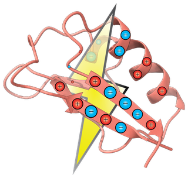

PyCPET
======

.. rst-class:: hero-tagline

PyCPET, or Python-based Computation of Protein Electric Field Topology, is built for high-throughput accelerated calculations of several electrostatic properties of enzyme active sites from simulations. This program is flexible and scriptable for analysis of classical, quantum mechanical, or QM/MM electric fields and electrostatic potentials.

.. code-block:: console

    pip install pycpet

.. grid:: 1 2 3 3
   :gutter: 3

   .. grid-item-card:: :octicon:`download` Installation
      :link: Installation
      :link-type: doc

      Install from PyPI or the repository, and set up OpenMP threads.

   .. grid-item-card:: :octicon:`rocket` Getting started
      :link: GetStarted
      :link-type: doc

      Write an options file and run your first calculation.

   .. grid-item-card:: :octicon:`zap` Fields, topologies & potentials
      :link: FieldTopESP
      :link-type: doc

      Point and volume fields, electrostatic potentials, and streamline topologies.

   .. grid-item-card:: :octicon:`graph` Dynamics & clustering
      :link: Dynamics
      :link-type: doc

      Clustering and PCA of fields across trajectories and variants.

   .. grid-item-card:: :octicon:`gear` Options reference
      :link: Options
      :link-type: doc

      Every options file key, with its default and the methods that use it.

   .. grid-item-card:: :octicon:`code` API reference
      :link: apiref
      :link-type: doc

      The classes and functions behind ``cpet.py``, for scripting.

Quick start
-----------

Write an options file, ``options.json``:

.. code-block:: json

    {
        "CPET_method": "point_field",
        "inputpath": "./pdb",
        "outputpath": "./out",
        "center": {"method": "mean", "atoms": [{"C7": 378}, {"O9": 378}]}
    }

Then run:

.. code-block:: console

    cpet.py -o options.json

This computes the electric field at the midpoint of atoms C7 and O9 in residue 378, for every PDB file in ``./pdb``, and writes one line per structure to ``./out/point_field.dat``.

Key features
------------

- Computing point and 3D grid-based electric fields and electrostatic potentials
- Active site volume definitions and orientation by flexible selection of atoms/coordinates
- High-throughput distribution of streamlines for electric field topologies, with established benchmarking protocols
- High-throughput clustering molecular dynamics trajectories by either histograms of field streamlines or tensor decomposition of fields/electrostatic potentials. GPU-acceleration available.
- QM/MM electrostatic breakdown analysis, compatible with ORCA, Turbomole, and PySCF

If you use *PyCPET*, please :doc:`cite the PyCPET paper <citation>`.

.. toctree::
   :hidden:
   :maxdepth: 2
   :caption: User guide

   Installation
   GetStarted
   InputFiles
   AtomSpec
   FieldTopESP
   Parallel
   Visualization
   Dynamics
   SpecialScripts

.. toctree::
   :hidden:
   :maxdepth: 2
   :caption: Reference

   Options
   apiref

.. toctree::
   :hidden:
   :maxdepth: 2
   :caption: About

   citation
